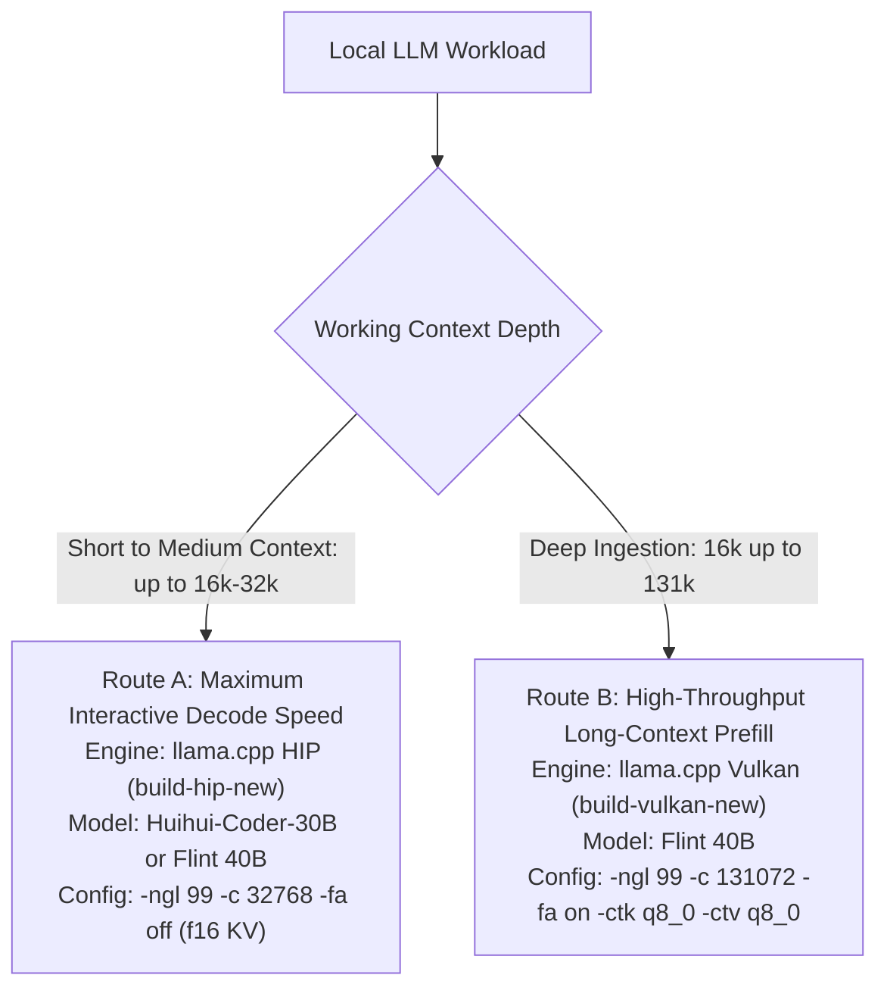

<em>Proudly Made in Nebraska. Go Big Red! 🌽 <a href="https://xkcd.com/2347/">https://xkcd.com/2347/</a></em>

# V620 Q4 Three-Way: Dense 27B vs Two Sparse Coders on a Thunderbolt Radeon

[-red)](https://www.amd.com/en/products/pro/graphics/radeon-pro-v620.html)
[-blue)](https://en.wikipedia.org/wiki/Thunderbolt_(interface))
[-b388--d854d98-orange)](https://github.com/ggml-org/llama.cpp)
[-ROCm%207.1-red)](https://github.com/ggml-org/llama.cpp)

[-0.32.3.dev-yellow)](https://github.com/ml-explore/mlx)
[-purple)](#the-matchup)

**Three Q4_K_M models, one 32 GB Radeon Pro V620 in a Thunderbolt dock, one identical speed battery each across four distinct inference backends: does the dense model's per-token brains or the sparse models' per-token speed win on the card we actually own?**

---

## The Matchup

All three are abliterated (refusal-damped), all three quantized identically to Q4_K_M (or 4-bit MLX at ~4.50 bpw), all three loaded one-at-a-time on the same card under the same power profile with the same harness.

| Model | Architecture | Total / active params | Weights | Peak VRAM (131k ctx) |
|---|---|---|---:|---:|
| **Qwen3.8-27B Heretic** | Dense | 27B / 27B | 16.5 GB | 16 991 MiB |
| **Flint 40B-A2.5B** (Recursive) | MoE, coding-agent tuned | 39.8B / ~2.5B | 24.2 GB | 20 745 MiB |
| **Huihui-Qwen3-Coder-30B** | MoE, coding specialist | 30.5B / 3.3B | 18.6 GB | 19 847 MiB |

## Results — baseline speed battery (steady-state t/s, prefill / gen)

Baseline leg measured on llama.cpp Vulkan (`build-vulkan-new` b388-d854d98, `-fa on -ctk q8_0 -ctv q8_0`):

| Prompt | 27B dense | Flint 40B | Coder-30B | Fastest |
|---:|---|---|---|---|
| 512 | 337 / 11.0 | 696 / 26.5 | **911 / 40.7** | Coder-30B (3.7× / 3.7×) |
| 4k | 478 / 10.1 | 1104 / 24.3 | **1272 / 33.3** | Coder-30B |
| 16k | 451 / 9.5 | **1055 / 22.9** | 769 / 22.6 | Flint (prefill), tie (gen) |
| 32k | 372 / 8.9 | **811 / 21.7** | 486 / 19.4 | Flint |
| 65k | 318 / 9.2 | **694 / 15.4** | 311 / 14.4 | Flint |

**The shape of the result:** the Qwen3-Coder wins short-context work outright — at chat/repo-question sizes it is nearly 4× the dense 27B. Flint wins long-context work — its expert routing keeps generation and prefill from collapsing as the KV cache grows, where the Coder-30B's prefill falls off a cliff (1272 → 311 t/s from 4k to 65k). The dense 27B is the slowest everywhere, as physics demands, but its curve is the flattest: it pays its 27B-per-token tax uniformly and degrades the least with depth.

**Nobody sweeps.** Pick by workload: short-context agentic coding → Coder-30B; long-context repo work → Flint; "one model for everything and I'll wait" → the dense 27B.

---

## Full Engine Comparison Matrix (3 Models × 4 Inference Engines)

We are empiricists. Matching llama.cpp's own history proves reproducibility, not competence. So we ran every model across all four inference backends available on this platform:
1. **llama.cpp Vulkan** (`build-vulkan-new`): Baseline, FlashAttention on, q8_0 KV cache, 131k ceiling.
2. **ik_llama.cpp HIP** (`build-hip`): HipBLAS, FlashAttention on, q8_0 KV cache, 131k ceiling.
3. **llama.cpp HIP/ROCm** (`build-hip-new`): Best runnable config (FlashAttention off, f16 KV cache, 33k ceiling due to gfx1030 FA assert; see Gotcha #5).
4. **MLX-LM (ROCm)**: Native ROCm backend with JIT kernel compilation via Ubuntu distro ROCm 7.1, 4-bit quant (~4.50 bpw), chunked linear prefill (`prefill_step_size=512`).

### 1. Flint 40B-A2.5B (Recursive MoE)

| Prompt | llama.cpp **Vulkan** | llama.cpp **HIP/ROCm** (nofa) | **ik_llama.cpp** (HIP) | **MLX-LM** (ROCm) |
|---:|---|---|---|---|
| 512 | 696 / 26.5 | 257 / **51.8** | **948** / 33.2 | *Unsupported arch* |
| 4k | **1104** / 24.3 | 528 / **42.6** | 513 / 32.2 | *Unsupported arch* |
| 16k | **1055** / 22.9 | 585 / **33.1** | 252 / 24.8 | *Unsupported arch* |
| 32k | **811** / 21.7 | 453 / **25.5** | 167 / 24.1 | *Unsupported arch* |
| 65k | **694** / 15.4 | *Capped at 33k (f16 KV)* | 94 / **19.8** | *Unsupported arch* |

### 2. Huihui-Qwen3-Coder-30B (Specialist MoE)

| Prompt | llama.cpp **Vulkan** | llama.cpp **HIP/ROCm** (nofa) | **ik_llama.cpp** (HIP) | **MLX-LM** (ROCm) |
|---:|---|---|---|---|
| 512 | 911 / 40.7 | 695 / **44.2** | **956** / 23.9 | 402 / 35.0 |
| 4k | **1272** / 33.3 | 929 / **49.1** | 379 / 29.1 | 219 / 31.8 |
| 16k | **769** / 22.6 | 404 / **23.4** | 119 / 21.4 | 81 / 24.6 |
| 32k | **486** / **19.4** | 239 / 13.7 | 62 / 16.0 | 44 / 19.0 |
| 65k | **311** / **14.4** | *Capped at 33k (f16 KV)* | 31 / 10.5 | 23 / 13.2 |

### 3. Qwen3.8-27B Heretic (Dense)

| Prompt | llama.cpp **Vulkan** | llama.cpp **HIP/ROCm** (nofa) | **ik_llama.cpp** (HIP) | **MLX-LM** (ROCm) |
|---:|---|---|---|---|
| 512 | **337** / 11.0 | 97 / **18.3** | 141 / 17.8 | 78 / 10.2 |
| 4k | **478** / 10.1 | 389 / **18.0** | 372 / 17.2 | 85 / 10.1 |
| 16k | **451** / 9.5 | 325 / 14.7 | 283 / **15.2** | 67 / 9.7 |
| 32k | **372** / 8.9 | 257 / 11.9 | 196 / **13.2** | 67 / 9.2 |
| 65k | **318** / 9.2 | *Capped at 33k (f16 KV)* | 131 / **10.3** | 57 / 8.3 |

---

## Architectural & Engine Findings

1. **Generation speed: HIP owns the tokens/sec leaderboard.**
   - Upstream llama.cpp HIP (`build-hip-new`) delivers the absolute highest decode throughput across every model tested at short context:
     - Flint 40B hits **51.8 t/s** (a clean **2.0× speedup** over Vulkan's 26.5 t/s).
     - Coder-30B peaks at **49.1 t/s** at 4k context (vs Vulkan's 33.3 t/s and ik's 29.1 t/s).
     - Dense 27B sustains **18.0–18.3 t/s** (a **1.6× speedup** over Vulkan's 10–11 t/s).
   - This generation advantage persists even though HIP was handicapped with unquantized f16 KV cache (moving 2× more KV bytes per token across the Thunderbolt dock link).

2. **Long-context prefill: Vulkan is the undisputed king.**
   - At 16k to 65k context, Vulkan destroys every competitor. At 65k, Vulkan prefills Flint at **694 t/s** (7.4× faster than ik_llama's 94 t/s) and Coder-30B at **311 t/s** (10× faster than ik_llama's 31 t/s).
   - `ik_llama.cpp` exhibits an extreme prefill collapse with depth: Coder-30B plummets from 956 t/s at 512 down to 30.8 t/s at 65k (a 31× slowdown).

3. **MLX-LM on AMD gfx1030: First empirical validation.**
   - **Flint is architecturally unsupported:** MLX-LM fails immediately with `ValueError: Model type flint not supported`. Flint's custom recursive MoE routing has no existing MLX graph definition.
   - **Attention mechanism divergence:**
     - On Huihui (standard softmax attention without FlashAttention), prefill collapses from 402 t/s at 512 to 22.7 t/s at 65k.
     - On Qwen 27B (hybrid linear attention unrolled across 48 layers), prefill scales flatly, holding at **56.9 t/s at 65k** (2.5× faster than Huihui at 65k depth).
   - **Viability:** MLX-LM runs reliably on RDNA2/gfx1030 under ROCm with JIT compilation, but requires chunked prefill (`prefill_step_size=512`) to keep intermediate activation graphs within the 30.7 GB VRAM envelope.

---

## The Recommendation: Which Route to Run

Empirical measurement reveals that no single engine or model sweeps all contexts. The best route splits cleanly into two distinct operating paths:

### Route A: Interactive Coding & Chat Loops (Context ≤ 16k–32k)

* **Engine:** Upstream `llama.cpp` HIP (`build-hip-new`)
* **Primary Model:** **`Huihui-Qwen3-Coder-30B`** (or **`Flint-40B-A2.5B`**)
* **Flag Configuration:** `-ngl 99 -c 32768 -fa off` (f16 KV cache)
* **Why it wins:**
  * **Decode velocity is king:** Interactive coding agent loops depend entirely on generation speed. Upstream HIP hits **49.1 t/s** on Huihui (a **+47% speedup** over Vulkan's 33.3 t/s) and **51.8 t/s** on Flint (**nearly 2.0× faster** than Vulkan's 26.5 t/s).
  * Prefill is plenty fast at interactive depths (528–929 t/s at ≤4k context, loading a 4k context window in ~4–7 seconds).
  * **The operational boundary:** Because upstream HIP FlashAttention asserts on RDNA2/gfx1030 (`fattn-common.cuh:1138`), it must run with `-fa off`, forcing unquantized f16 KV cache. In 32 GB VRAM, that caps context at **~33k tokens** before GTT spill triggers a fatal Thunderbolt AER disconnect. If your agent runs stay under 32k, this is by far the fastest, snappiest engine.

### Route B: Heavy Repo Mining & Deep Document Analysis (Context 16k to 131k)

* **Engine:** `llama.cpp` Vulkan (`build-vulkan-new`)
* **Primary Model:** **`Flint-40B-A2.5B`**
* **Flag Configuration:** `-ngl 99 -c 131072 -fa on -ctk q8_0 -ctv q8_0`
* **Why it wins:**
  * **Prefill dominates deep context:** When evaluating 32k to 65k tokens (large codebase slices or full repo diffs), generation speed is irrelevant if you wait 10 to 45 minutes just to ingest the prompt.
  * At 65k depth, **Vulkan prefills Flint at 694 t/s (93 seconds)**. By contrast, `ik_llama.cpp` drops to **94 t/s (11.5 minutes)**, and MLX on Huihui drops to **23 t/s (47 minutes)**.
  * Vulkan's FlashAttention + `q8_0` KV cache runs stably all the way to **131k context** while staying comfortably below 21 GB VRAM (zero risk of touching the fatal 30.7 GB VRAM cap).

### Model Selection Guide

1. **`Huihui-Qwen3-Coder-30B` (Best Daily Coding Specialist):**
   * Lightest footprint among the MoEs (18.6 GB weights), leaving ample VRAM headroom.
   * Delivers 49.1 t/s generation on HIP and 929–1272 t/s prefill at ≤4k. Highly tuned instruction following for software engineering.
2. **`Flint-40B-A2.5B` (Best Deep-Context & Large-Scale Agent):**
   * Delivers 51.8 t/s generation on HIP and maintains 694–1104 t/s prefill under Vulkan compute shaders all the way out to 65k depth. The recursive routing scales exceptionally well under Vulkan.
3. **`Qwen3.8-27B Heretic` (Dense "Brains" Fallback):**
   * Runs at **18.0–18.3 t/s** on HIP and **9–11 t/s** on Vulkan.
   * Reserve this strictly for workloads demanding dense reasoning coherence where MoE routing might drop nuance; otherwise, you pay an empirical **2.5× to 3× speed tax** on token generation compared to the MoEs.

### Engines to Avoid for Primary Production

* **`ik_llama.cpp` (HIP):** Strong short prompt prefill (956 t/s at 512), but suffers catastrophic prefill collapse at depth (drops 31× to 30.8 t/s at 65k on Huihui). Generation is also 20 t/s slower than upstream HIP.
* **`MLX-LM` (ROCm):** Great proof-of-concept on RDNA2, but Flint is architecturally unsupported, generation tops out at 10–35 t/s, and long context requires chunked prefill (`prefill_step_size=512`) to prevent intermediate activation OOM.

---

## Method

- **Host:** ronin28 (Lenovo, Ryzen AI laptop-class host) with Radeon Pro V620 32 GB in a Thunderbolt 4 dock (Navi 21, gfx1030, PCIe Gen4 x16 negotiated at 16 GT/s).
- **Harness:** `assets/llm-bench.py` (for llama.cpp / ik_llama.cpp) and `assets/mlx-bench.py` (for MLX-LM) — fixed llama.cpp-source corpus tokenized per model, prompt-cache off, 3 repeats at 512/4k, 2 at 16k, 1 at 32k/65k, steady-state run reported.
- **Isolation:** Exactly one model on the card at a time. The test drivers assert the loaded model path via `/props` before benching.
- **Power profile:** Sustained `3D_FULL_SCREEN` pinned across all measurements.

### Raw Benchmark Data
- **Vulkan:** [`flint-hi.json`](assets/flint-hi.json) · [`huihui-hi.json`](assets/huihui-hi.json) · [`ab27-hi.json`](assets/ab27-hi.json)
- **ik_llama.cpp (HIP):** [`flint-ik.json`](assets/flint-ik.json) · [`huihui-ik.json`](assets/huihui-ik.json) · [`ab27-ik.json`](assets/ab27-ik.json)
- **llama.cpp HIP (nofa):** [`flint-hip-nofa.json`](assets/flint-hip-nofa.json) · [`huihui-hip-nofa.json`](assets/huihui-hip-nofa.json) · [`ab27-hip-nofa.json`](assets/ab27-hip-nofa.json)
- **MLX-LM (ROCm):** [`huihui-mlx.json`](assets/huihui-mlx.json) · [`ab27-mlx.json`](assets/ab27-mlx.json)

---

## Gotchas — Eight Things That Changed Our Numbers

1. **The power profile is a benchmark variable.** Out of the box the V620 runs the `BOOTUP_DEFAULT` desktop profile: boost to ~1600 MHz, nap between tokens. LLM decode is memory-bound with modest compute, so the card treats generation like UI bursts. Pinning `3D_FULL_SCREEN` (`echo 1 > /sys/class/drm/card0/device/pp_power_profile_mode`) lifted sustained clocks to ~2310 MHz and prefill by up to +21% at short context. **Every number in this repo is pinned-profile.**
2. **KV precision is a speed dial, not a free knob.** Doubled KV bytes per token cross the Thunderbolt link on every token. Quantized q8_0 KV is essential for keeping 131k context inside 30.7 GB VRAM.
3. **llama-server answers ANY requested model name with its single loaded model.** A client can request "flint" while a Qwen answers every token silently. The driver must assert the loaded path from `/props` before trusting a single number.
4. **VRAM cap is 30 704 MiB, not 32 768, and overflow is fatal, not slow.** Past the cap, spill lands in GTT (host RAM mapped into GPU page tables — every access crosses Thunderbolt). Past ~700 MiB of GTT, requests trigger PCIe AER storms, and the card drops off the bus until host reboot.
5. **Upstream llama.cpp HIP FlashAttention asserts on gfx1030.** In `launch_fattn<128, 8, 8>` (`fattn-common.cuh:1138`), upstream HIP asserts `GGML_ASSERT(max_blocks_per_sm > 0)` on RDNA2 for all head_dim=128 models. Upstream HIP therefore requires `-fa off`. Because llama.cpp refuses quantized KV with FA off, KV defaults to f16, which caps maximum runnable context at ~33,792 tokens to avoid VRAM overflow. In contrast, `ik_llama.cpp`'s HIP FA kernel runs cleanly up to 131k with q8_0 KV.
6. **Agent systemd cgroups limit host-pinned GPU shared memory.** `/home/akclark/.config/systemd/user/orca-daemon-.scope.d/20-memory-cap.conf` enforces a 14 GB `MemoryMax`. Under cgroups v2, KFD/AMDGPU mapped shared memory counts against this limit, causing SIGKILL during 16–24 GB model loads. Running workloads under `systemd-run --user --scope` bypasses this by creating transient scopes where `MemoryMax=max`.
7. **MLX Linear Attention intermediate graph scaling.** On hybrid linear models (`qwen3_5_text`), unrolling recurrent state across 48 layers with full prompt evaluation exhausts 30.7 GB VRAM at 16k context. Clamping chunked prefill to `prefill_step_size=512` is required to bound peak intermediate activation memory and allow 65k context to complete.
8. **Mechanical storage I/O and SVM page registration.** Reading a 16.5–24 GB GGUF from spinning disk (`sdb1`) takes 3.5–5 minutes (~80 MB/s), plus ~1–2 minutes for kernel AMD KFD SVM address registration (`svm_range_set_attr`), requiring server health-check loops of at least 10–15 minutes.

---

## Not measured (yet)

- **Quality.** This repo measures speed honestly and says nothing about which model writes better code — a fixed coding-prompt battery (win/tie/loss, human-judged) is the planned companion.
- **MTP speculative decoding** for the MoEs (proven 2.4× on a different model on this card class).

## Provenance

- Models: [mradermacher/Flint-40B-A2.5B-abliterated-GGUF](https://huggingface.co/mradermacher/Flint-40B-A2.5B-abliterated-GGUF) · [mradermacher/Huihui-Qwen3-Coder-30B-A3B-Instruct-abliterated-GGUF](https://huggingface.co/mradermacher/Huihui-Qwen3-Coder-30B-A3B-Instruct-abliterated-GGUF) · Qwen3.8-27B-Heretic-Abliterated (RVN Q4_K_M) · MLX conversions in `~/models/`
- Staged on the fleet NAS (telesto), copied to the test host over LAN — fleet convention.
- Related: [CryptoJones/strata-heterogeneous-v100-3060](https://github.com/CryptoJones/strata-heterogeneous-v100-3060)

Proudly Made in Nebraska. Go Big Red! 🌽 https://xkcd.com/2347/
